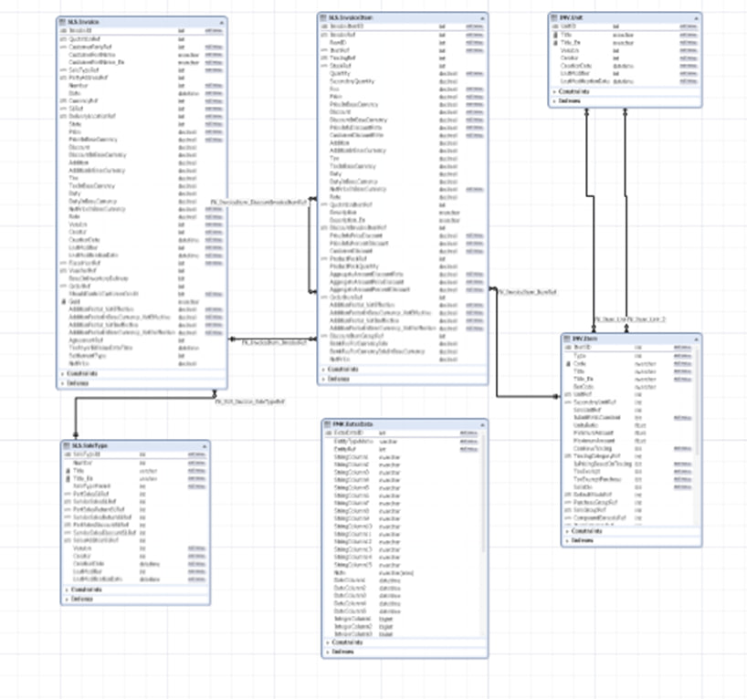

# Sales Data Analysis of a Grocery Business with SQL
SQL analysis of a grocery business's sales data from a real Sepidar ERP database — answering 10 real business questions with T-SQL (JOINs, CTEs, Subqueries, Window Functions)
#  Sales Analysis for a Grocery Business (SQL Server)

this project is a sales analysis for a grocery business, done with **SQL Server**.

What makes this project special is that the data comes from a **real database of Sepidar** (one of the most widely used accounting/sales ERP systems in Iran). That means I was dealing with the real, messy structure of an ERP: dozens of tables, complex relationships. My first step was studying the ERD and mapping out table relationships before writing a single query.

---

##  Business Context

The business in question is an active **spices & food products retailer**. The data includes product, customer, and seller information. The goal of the project was to answer real, operational business questions such as:

- Analyzing sales channels and each channel's share of total invoices
- Customer purchasing behavior (order counts and dates)
- Finding products that have never been sold
- Building a comprehensive sales report at the level of **date × seller × product × sales channel**

---

##  Database Structure

| Table | Description |
|---|---|
| `SLS.Invoice` | Sales invoices |
| `SLS.InvoiceItem` | Invoice line items |
| `INV.Item` | Product information |
| `SLS.SalesType` | Sales types (sales channels) |
| `INV.Unit` | Units of measurement |
| `FMK.ExtraData` | Extra entity data (e.g., product weight) |

**Relation Between Database's Tables**




---

##  Business Questions Answered

| # | Business Question | Main Technique |
|---|---|---|
| 1 | What are the distinct sales channels? | `DISTINCT` |
| 2 | How many invoices per sales channel? | `COUNT` + `GROUP BY` |
| 3 | What is each channel's relative percentage share? | Window Function + `CAST` |
| 4 | How many orders per customer, plus the grand total? | Window Function |
| 5 | Most recent & oldest order date for each customer? | `MAX` / `MIN` + `GROUP BY` |
| 6 | Most recent & oldest order date across the entire business (not per customer)? | Subquery |
| 7 | Products whose name starts with a specific term? | `LIKE` on Persian text |
| 8 | Invoice items of those products? | `JOIN` + Subquery (two solutions) |
| 9 | Products that have never been ordered? | Anti-Join + `NOT IN` (two solutions) |
| 10 | Comprehensive sales report (quantity, revenue & weight) | CTE + `JOIN` across 7 tables |

---

##  Skills & Techniques Used

-  `SELECT`, `WHERE`, `GROUP BY`, `ORDER BY`, and aggregate functions (`COUNT`, `SUM`, `MAX`, `MIN`)
-  **Window Functions** with `OVER()` — computing percentage shares and grand totals alongside row-level details
-  `CAST` and decimal precision control in percentage calculations
-  Inner & outer joins (`INNER` / `LEFT JOIN`) and the **Anti-Join** pattern for finding unmatched records
-  Subqueries with `IN` and `NOT IN`
-  **CTEs** (`WITH`) to keep complex queries readable
-  Joining **7 tables** at once with correct key relationships
-  Pattern matching (`LIKE`) on non-English text (`nvarchar` with the `N` prefix)
-  Handling `NULL` values (`ISNULL`, `LEFT JOIN ... IS NULL`)
-  **Performance awareness**: adding date filters to cut execution time on thousands of records


---

### Here's the comprehensive report query using a CTE:

```sql
USE sepidar01;

WITH CombinedData AS (
    SELECT
        CAST(i.Date AS DATE)   AS InvoiceDate,
        u.UserID               AS SellerID,
        u.Name                 AS SellerName,
        itm.ItemID             AS ProductID,
        itm.Title              AS ProductName,
        un.Title               AS UnitName,
        st.Title               AS SaleTypeName,
        ii.Quantity,
        ii.NetPrice,
        (ii.Quantity * ISNULL(ed.IntegerColumn3, itm.Weight)) AS NetWeight
    FROM SLS.InvoiceItem AS ii
    LEFT JOIN SLS.Invoice AS i
        ON ii.InvoiceRef = i.InvoiceId
    LEFT JOIN INV.Item AS itm
        ON ii.ItemRef = itm.ItemID
    LEFT JOIN INV.User AS u
        ON i.Creator = u.Creator
    LEFT JOIN SLS.SaleType AS st
        ON i.saleTypeId = st.saleTypeId
    LEFT JOIN INV.Unit AS un
        ON itm.UnitID = un.UnitID
    LEFT JOIN FMK.ExtraData AS ed
        ON itm.ItemID = ed.EntityRef
    WHERE CAST(i.Date AS DATE) <= '2018-03-25'
      AND ed.EntityTypeName = 'SG.Inventory.ItemManagement.Common.DsItem'
)
SELECT
    InvoiceDate,
    SellerID,
    SellerName,
    ProductID,
    ProductName,
    UnitName,
    SaleTypeName,
    SUM(Quantity)  AS TotalQuantity,
    SUM(NetPrice)  AS TotalNetSales,
    SUM(NetWeight) AS TotalNetWeight
FROM CombinedData
GROUP BY
    InvoiceDate,
    SellerID,
    SellerName,
    ProductID,
    ProductName,
    UnitName,
    SaleTypeName
ORDER BY
    SellerID,
    SellerName,
    TotalQuantity ASC;
```

---


## 🗂️ Repository Structure
```                   
 ┣ assets/                           # screenshots used in this README
 ┃ ┣ Dashboard-preview.jpg
 ┃ ┣ Total-Sales-Trend.jpg
 ┃ ┣ Relation-between-tables.jpg
 ┃ ┣ Top-8-Sales-By-Product.jpg
 ┃ ┣ Top-Sales-By-Product-Categories.jpg
 ┃ ┗ Average-Discount-By-Category.jpg
 ┣ report/
 ┃ ┗ Sales Analysis for a Grocery Business.pdf
 ┗ README.md
```

---


## 📬 How to  Contact!

-  **Data Analyst:** Mohammadhasan Pourkabgani
-  **LinkedIn** — [MohammadHasan Pourkabgani](https://www.linkedin.com/in/mohammadhasan-pourkabgani/)
-  **GitHub** — [Hasanprk](https://github.com/Hasanprk)
-  **Email** — mh.pourkabgani91@gmail.com

If you found this project useful or have any feedback, I'd genuinely love to hear it! 
